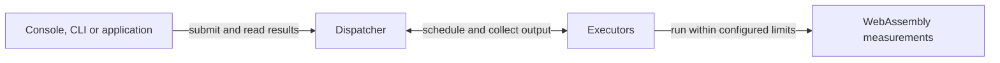

# Debuglet

Debuglet lets you program network measurements and run them from different
vantage points. Start with a template, connect blocks in the visual editor, or
write a WebAssembly program using the Go SDK. Collect results from one executor
or coordinate an experiment across several.

> Debuglet is intended for managed, trusted environments. Read the [security policy](SECURITY.md) before operating a networked deployment.

## Start here

Open the [hosted console](https://debuglet.netsec.ethz.ch/console/) and sign in
with an available provider. Choose a template, select a ready executor and run
it with TEST, then inspect the output in Results. The
[first measurement walkthrough](docs/measurements.md#run-your-first-measurement)
covers each step. TEST needs no crypto wallet; it needs sufficient
operator-granted allowance if the deployment enforces one.

| I want to… | Guide |
| --- | --- |
| Use the hosted site | [Run an experiment](docs/measurements.md#run-your-first-measurement); no local installation needed. |
| Host an executor | [Connect an Ubuntu 24.04 amd64 machine](docs/operations/executor-onboarding.md). |
| Develop with Debuglet | [CLI, Go SDK and MCP starting points](CONTRIBUTING.md#develop-with-debuglet), then the contribution workflow. |

Build experiments with templates or the [visual editor](docs/development/workflow-authoring.md).
The AI assistant is optional and in beta; review its proposed experiment and
results. Ordinary editing and execution do not require AI.

## Try it locally

[Install a compatible full package](README-install.md), then run:

```sh
dbl demo
```

The demo starts a temporary dispatcher and executor, runs a measurement and
cleans up. It needs no account, wallet, compiler or root access. Success ends
with `Cleanup: complete`. See [troubleshooting](docs/operations/troubleshooting.md)
if it fails.

## How it fits together



The **dispatcher** authenticates users, schedules work and stores results.
**Executors** connect outward to it and run measurements under their operators'
network and resource policies. See [architecture](docs/architecture.md) for the
interfaces and execution flow.

## Documentation

The [documentation index](docs/README.md) links to user guides, CLI/API references
and deployment instructions. The same source is published on the
[documentation site](https://debuglet.netsec.ethz.ch/docs/). Use the guide for your
installed version; see [compatibility](docs/versions.md) and the
[releases page](https://github.com/netsec-ethz/debuglet/releases).

## License

[Apache License 2.0](LICENSE).
