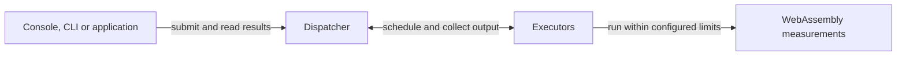

# Debuglet

Debuglet lets you program network measurements and run them from different
vantage points. Start with a template, connect blocks in the visual editor, or
write a WebAssembly program using the Go SDK. Collect results from one executor
or coordinate an experiment across several.

> Debuglet is an alpha for trusted environments. Read the [security policy](SECURITY.md) before operating a networked deployment.

## Start here

Open the [hosted console](https://debuglet.netsec.ethz.ch/console/) and sign in
with an available provider. You do not need to install a dispatcher or executor
to use existing nodes.

| I want to… | Guide |
| --- | --- |
| Run my first experiment | [Choose a template, run it and read the result](docs/measurements.md#run-your-first-measurement) |
| Host an executor | [Install and connect a machine](docs/operations/executor-onboarding.md) |
| Build my own experiment | [Visual editor and AI/MCP](docs/development/workflow-authoring.md), or [Go SDK](docs/debuglets.md) |
| Contribute to Debuglet | [Find the code, make a change and test it](CONTRIBUTING.md) |

## Try it locally

[Install a compatible full package](README-install.md), then run:

```sh
dbl demo
```

The demo starts a temporary dispatcher and executor, runs a measurement and
cleans up. It needs no account, wallet, compiler or root access. Success ends
with `Cleanup: complete`. See [troubleshooting](docs/operations/troubleshooting.md)
if it fails.

## How it fits together



The **dispatcher** authenticates users, schedules work and stores results.
**Executors** connect outward to it and run measurements under their operators'
network and resource policies. See [architecture](docs/architecture.md) for the
interfaces and execution flow.

## Documentation

The [documentation index](docs/README.md) links to user guides, CLI/API references
and deployment instructions. The same source is published on the
[documentation site](https://debuglet.netsec.ethz.ch/docs/). Use the guide for your
installed version; see [compatibility](docs/versions.md) and the
[releases page](https://github.com/netsec-ethz/debuglet/releases).

## License

[Apache License 2.0](LICENSE).
